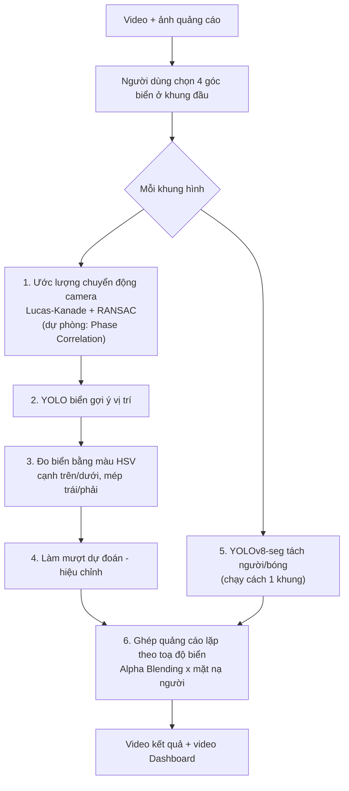

# Quang_cao_ao_the_thao
# Mô phỏng quảng cáo ảo (Virtual Advertising) trong phát sóng thể thao


| Hoàng Nhất Công |
Chương trình Python mô phỏng công nghệ **quảng cáo ảo**: tự động **thay quảng cáo trên biển ven sân** trong một video thể thao bằng ảnh quảng cáo khác, sao cho quảng cáo **bám theo biển** khi camera quay/zoom và **cầu thủ vẫn đứng phía trước** (không bị quảng cáo đè lên).

Đây là bài tập lớn môn **Đa phương tiện** – Khoa Điện – Điện tử, Trường Đại học Giao thông Vận tải. Chương trình chỉ dùng **xử lý ảnh + học sâu**, chạy **ngoại tuyến** trên video có sẵn, nhằm minh họa nguyên lý chứ không thay thế các hệ thống truyền hình thương mại.

> *English summary:* an offline Python/OpenCV/YOLO simulation of virtual advertisement replacement on a perimeter board in sports video, with camera-motion tracking (Lucas–Kanade + RANSAC, phase-correlation fallback), player occlusion masks (YOLOv8-seg) and alpha-blended compositing.

---

## Tính năng

- **Phát hiện biển** bằng YOLO tự huấn luyện (chỉ làm gợi ý) và **đo lại 4 cạnh trực tiếp bằng màu** (đỏ + chữ trắng + mép cỏ).
- **Theo dõi chuyển động camera** bằng Lucas–Kanade (kim tự tháp ảnh, kiểm tra xuôi/ngược) + RANSAC; dự phòng bằng Phase Correlation.
- **Neo quảng cáo theo biển**: ảnh quảng cáo được vẽ lặp theo toạ độ của biển và trượt cùng biển khi camera quay.
- **Tách cầu thủ/bóng** bằng YOLOv8-seg, mặt nạ mềm, giữ nguyên hình gốc ở chỗ có người.
- **Trộn Alpha** có viền mềm, làm mờ nhẹ ảnh quảng cáo cho gần với video nén.
- **Dashboard 4 ô** để quan sát từng bước, và xuất **hai video**: kết quả sạch và video 4 khung.
- Cơ chế an toàn: mất biển quá 5 khung thì xuất khung hình gốc; chọn lại 4 góc bằng phím `S`.

---

## Quy trình xử lý



Chi tiết từng bước nằm trong báo cáo và slide đi kèm (xem mục *Tài liệu*).

---

## Cài đặt

Yêu cầu: **Python 3.9 trở lên**.

```bash
git clone https://github.com/<tên-tài-khoản>/<tên-repo>.git
cd <tên-repo>

python -m venv .venv
# Windows: .venv\Scripts\activate
# Linux/macOS: source .venv/bin/activate

pip install -r requirements.txt
```

`requirements.txt`:

```
ultralytics
opencv-python
numpy
```

Lần chạy đầu tiên, thư viện sẽ tự tải `yolov8n-seg.pt` (khoảng 7 MB) nên cần có mạng.

---

## Chuẩn bị dữ liệu

Repo **không chứa** video thể thao, ảnh quảng cáo và tệp trọng số lớn. Bạn cần tự đặt:

| Thành phần | Mô tả |
|---|---|
| Video đầu vào | Video thể thao có biển quảng cáo ven sân (ví dụ `data/video.mp4`) |
| Ảnh quảng cáo | Ảnh sẽ thay vào biển (ví dụ `data/ad.png`) |
| `weights.pt` (tuỳ chọn) | Mô hình YOLO nhận diện biển, nhãn `bang_led`. Nếu thiếu, chương trình vẫn chạy bằng màu + chuyển động camera |

Mở tệp `Homography_Video.py` và sửa các đường dẫn ở đầu tệp:

```python
DEFAULT_VIDEO  = r"data/video.mp4"
DEFAULT_AD     = r"data/ad.png"
DEFAULT_OUTPUT = r"output/ket_qua.mp4"

BILLBOARD_MODEL_PATH = r"models/weights.pt"

SAVE_DASHBOARD   = True
DASHBOARD_OUTPUT = r"output/dashboard_4_khung.mp4"
```

---

## Cách chạy

```bash
python Homography_Video_V17.py
```

1. Cửa sổ chọn góc hiện ra: **click 4 góc** của biển theo thứ tự *trái-trên → phải-trên → phải-dưới → trái-dưới*, rồi nhấn **Enter**.
2. Chương trình xử lý từng khung và hiển thị Dashboard.
3. Kết quả được ghi vào các video đầu ra.

| Phím | Tác dụng |
|---|---|
| `Enter` | Xác nhận 4 góc |
| `R` | Xóa, chọn lại (khi đang chọn góc) |
| `S` | Chọn lại 4 góc giữa chừng (giữ nguyên vị trí neo quảng cáo) |
| `ESC` | Thoát (vẫn lưu phần đã xử lý) |

**Chọn khung đầu** là khung mà biển không bị cầu thủ che, để 4 góc chính xác.

### Dashboard 4 ô

1. Khung hình có hộp YOLO (vàng) và hộp đo được (xanh).
2. Mask màu biển (đỏ/trắng) dùng để đo 4 cạnh.
3. Mặt nạ người (YOLOv8-seg).
4. Kết quả (có chữ gỡ lỗi).

Video kết quả (`DEFAULT_OUTPUT`) **không** có chữ gỡ lỗi. Đặt `SHOW_DEBUG_ON_OUTPUT = True` nếu muốn ghi cả viền xanh.

---

## Các tham số hay chỉnh

| Tham số | Mặc định | Ý nghĩa |
|---|---|---|
| `BOARD_HUE_RANGES` | `[(0,10),(170,179)]` | Khoảng sắc độ (HSV) của biển. **Biển màu khác phải đổi** |
| `YOLO_DEVICE` | `"cpu"` | Đổi thành `"cuda"` nếu có GPU NVIDIA |
| `YOLO_INTERVAL` | `2` | Chạy phân đoạn người cách N khung (tăng để nhanh hơn) |
| `BILLBOARD_INTERVAL` | `1` | Chạy YOLO biển cách N khung |
| `SMOOTH_ALPHA` | `0.35` | Hệ số làm mượt hộp biển |
| `AD_ALPHA` | `0.98` | Độ đậm của quảng cáo |
| `AD_TILE_GAP_RATIO` | `0.0` | Khoảng trống giữa các ảnh lặp (0 = liền nhau) |
| `PERSON_DILATE_PX` | `1` | Giãn mặt nạ người; tăng nếu sót viền, giảm nếu lộ viền biển gốc |
| `MASK_COMP_MODE` | `"object"` | Cách dịch mặt nạ ở khung bỏ qua phân đoạn |
| `LOST_LIMIT` | `5` | Mất biển quá số khung này thì xuất hình gốc |

---

## Mô hình YOLO phát hiện biển (tuỳ chọn)

Nhóm tự làm bộ dữ liệu từ video thử: tách khung hình, gán nhãn một lớp `bang_led` trên **Roboflow** (153 ảnh, chia Train/Valid/Test), huấn luyện rồi xuất `weights.pt`. Mô hình chỉ **gợi ý** vị trí; 4 cạnh cuối cùng vẫn được đo lại bằng màu.

Lưu ý: bộ dữ liệu lấy từ một video nên các cảnh khá giống nhau; muốn dùng cho video khác cần thêm dữ liệu đa dạng hơn.

---

## Hạn chế

- Chạy **ngoại tuyến**, chưa thời gian thực; tốc độ phụ thuộc cấu hình máy và YOLO.
- Phải **chọn 4 góc bằng tay** ở khung đầu; chưa hoàn toàn tự động.
- Biển được xấp xỉ bằng **hình chữ nhật thẳng**, dùng phép biến đổi đồng dạng (tịnh tiến, quay, co giãn) chứ **chưa phải homography đầy đủ**, nên chưa tái hiện được độ nghiêng phối cảnh. *(Tên tệp giữ lại theo lịch sử dự án.)*
- Vị trí neo quảng cáo được **cộng dồn** theo từng khung nên có thể trôi dần trên video dài; dùng `S` để xác nhận lại.
- Phần đo mép dùng **màu biển** (mặc định đỏ + chữ trắng), nên cần đổi tham số cho biển màu khác; không phù hợp với biển LED đổi màu liên tục.
- Mặt nạ cầu thủ (mô hình `yolov8n-seg` nhỏ) có thể kém khi nhiều người chồng lấn hoặc di chuyển rất nhanh.
- Chưa khớp màu/độ sáng của quảng cáo với video gốc, ngoài việc làm mờ nhẹ.


## Cấu trúc thư mục gợi ý

```
.
├── Homography_Video_V17.py   # chương trình chính
├── requirements.txt
├── models/                   # weights.pt (không đưa lên git nếu nặng)
├── data/                     # video, ảnh quảng cáo (không đưa video lên git)
├── output/                   # video kết quả
├── docs/                     # ảnh, GIF demo, báo cáo, slide
└── README.md
```

| Hoàng Nhất Công |

Giảng viên hướng dẫn: **TS. Lê Xuân Chiến** – Khoa Điện – Điện tử, Trường Đại học Giao thông Vận tải.

---

## Giấy phép và bản quyền

- Thư viện **Ultralytics YOLO** được phát hành theo giấy phép **AGPL-3.0**; nếu bạn phân phối lại chương trình dùng thư viện này, hãy tìm hiểu điều kiện của giấy phép đó.
- Video thể thao, logo thương hiệu (Coca-Cola, IKEA) và các ảnh trích từ nguồn khác thuộc quyền của chủ sở hữu; repo chỉ dùng cho **mục đích học tập**, không chứa các tệp này.

## Tham khảo

- B. D. Lucas, T. Kanade, *An Iterative Image Registration Technique with an Application to Stereo Vision*, IJCAI, 1981.
- M. A. Fischler, R. C. Bolles, *Random Sample Consensus: A Paradigm for Model Fitting…*, Communications of the ACM, 1981.
- Tài liệu OpenCV: `calcOpticalFlowPyrLK`, `estimateAffinePartial2D`, `phaseCorrelate`.
- Ultralytics YOLOv8: https://docs.ultralytics.com
